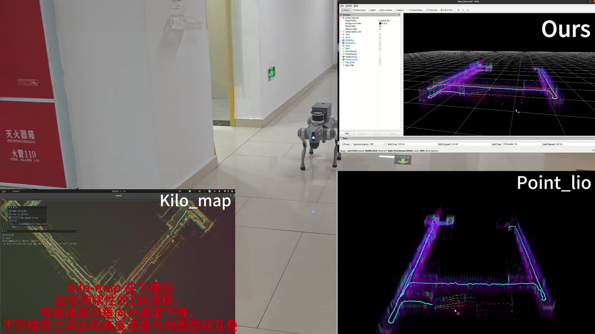

# Quadruped Multi-Floor SLAM

**State-Adaptive Structural Constraints for LiDAR–Inertial SLAM on Quadruped Robots in Multi-Floor Environments**

[English](#overview) | [中文](#项目简介)

## Demonstration

[][demo]

[Download the full demonstration (196 MiB)][demo]. The video shows quadruped locomotion and mapping results, including visual comparisons with FAST-LIO, Point-LIO and KILO-Map. GitHub does not preview the full-size video on the file page.

The original video is stored with Git LFS. After cloning, use `git lfs pull` if the video has not been downloaded automatically.

## Overview

This project studies LiDAR–inertial SLAM for quadruped robots moving through multi-floor indoor environments. Gait-induced motion, rapid attitude changes and stair traversal can introduce vertical drift and inconsistent floor geometry. The proposed method combines point-wise LiDAR–inertial state estimation with structural constraints that adapt to the robot's motion and the reliability of local ground observations.

### Key ideas

- **State-adaptive observations:** Evaluate local ground-plane quality together with motion state. When appropriate, ground-normal and reference-plane constraints are incorporated into the iterated error-state Kalman filter; constraints are weakened or disabled during unstable transitions and stair traversal.
- **Floor-state confirmation:** Combine evidence from vertical motion, stability and ground structure to identify floor transitions and maintain floor-level references.
- **Floor-aware optimization:** Use intra-floor height and orientation consistency together with inter-floor relative-height constraints to improve the vertical consistency of the resulting map.

### Experimental context

The reported experiment follows a quadruped robot through a real indoor sequence from 3F to 2F to 1F. Across the stable portions of the three floors, the proposed method reports a mean vertical position standard deviation of **0.0832 m** and a mean vertical-drift slope of **0.3520 cm per 10 m**. The floor-height analysis assesses relative ordering and separation; an independent absolute height reference was not available in this experiment.

## Repository status

This repository currently contains the project overview and demonstration. Source code and experimental datasets are not included at present.

---

## 项目简介

本项目研究四足机器人在室内多楼层环境中的激光雷达–惯性同步定位与建图。针对步态振动、姿态变化和楼梯通行带来的垂直漂移与楼层结构不一致问题，方法在逐点激光–惯性状态估计的基础上，结合机器人运动状态和局部地面观测质量，自适应地使用结构约束。

主要思路包括：

1. **状态自适应结构观测：** 在地面可靠且运动状态适合时，将地面法向和参考平面约束加入迭代误差状态卡尔曼滤波；在楼梯和不稳定过渡阶段减弱或关闭不适用的约束。
2. **楼层状态确认：** 综合垂直运动、运动稳定性和地面结构信息，识别楼层转换并维护楼层参考。
3. **楼层一致性优化：** 利用楼层内的高度、姿态一致性和楼层间相对高度约束，改善多楼层地图的垂直结构一致性。

实验在真实室内场景中沿 3F → 2F → 1F 路线进行。三个楼层稳定区间的平均垂直位置标准差为 **0.0832 m**，平均垂直漂移斜率为 **0.3520 cm/10 m**。由于实验缺少独立的绝对高度参考，楼层高度分析侧重相对顺序和间隔，而非绝对高度精度。

目前仓库提供项目简介和[完整演示视频下载][demo]，暂不包含源代码和实验数据集。由于视频体积较大，GitHub 文件页面无法直接预览，点击链接可下载原视频。

[demo]: https://github.com/Gguocp2132/Quadruped-Multi-Floor-SLAM/raw/refs/heads/main/assets/slam-demo.mp4
